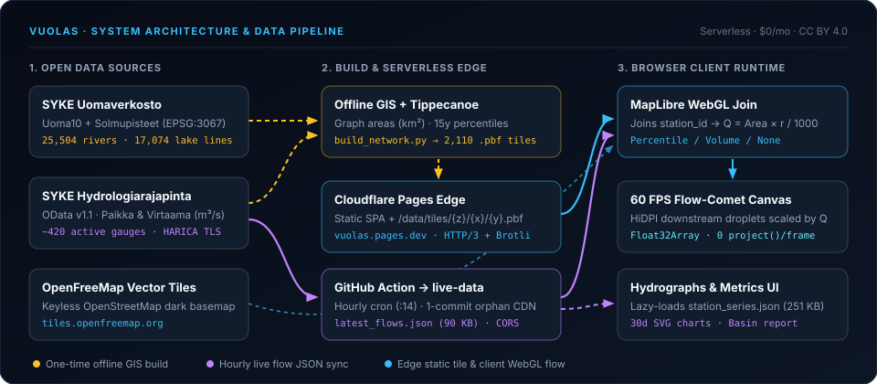

# Vuolas — Suomen jokivirtaamat

**Vuolas** (*Finnish for swift-flowing, abundant current*) is a serverless WebGL visualization of live river discharge (`m³/s`), 15-year historical flow percentiles (`p1–p99`), and national hydrological metrics across **42,578 Finnish river and lake-route segments**.



## Architecture at a Glance

```text
[SYKE Uoma10 GIS] ──(one-time)──► build_network.py ──► 2,110 .pbf tiles ──► Cloudflare Pages
                                         │                                        │
[SYKE OData API]  ──(15y stats)──────────┴─► stations_baseline.json               ▼
       │                                              │                    Browser (WebGL +
       └────────────(hourly :14)─► GitHub Action ─────┴─► live-data JSON ─► 60 FPS Canvas)
```

* **Interactive Explorer:** Open `/architecture.html` on the live site (or click **Guide → System Architecture & Data** inside the map UI).
* **Zero Runtime Database:** Static river geometry (`web/public/data/tiles/{z}/{x}/{y}.pbf`) is cached on Cloudflare Pages, while hourly SYKE readings (`latest_flows.json` 90 KB + `station_series.json` 251 KB) are force-pushed as a single commit to the orphan `live-data` branch so Git history never grows.

## Key Files

| Path | Role |
| :--- | :--- |
| `scripts/build_network.py` | Topological catchment accumulation, 15y station percentiles, station snapping, and GeoJSONL export |
| `scripts/fetch_live_flows.py` | Hourly SYKE OData v1.1 fetcher outputting `latest_flows.json` and 30-day `station_series.json` |
| `scripts/syke_http.py` | HTTPS client bundling `certifi` + `certs/harica_geant_intermediate.pem` for `*.ymparisto.fi` |
| `web/src/main.js` | MapLibre GL JS dynamic WebGL join, 60 FPS `Float32Array` flow-comet canvas, hydrographs & Metrics |
| `web/public/architecture.html` | Standalone interactive architecture & payload inspector |
| `.github/workflows/update-flows.yml` | Hourly cron (`:14`) publishing live JSON snapshots to the `live-data` branch |

## Local Development

```bash
# 1. Refresh live SYKE flows (~2 seconds)
uv run python scripts/fetch_live_flows.py
cp data/live/*.json web/public/data/

# 2. Launch Vite dev server
cd web && npm run dev
```

To rebuild the static `.pbf` vector tiles (`z4–z10`) and 15-year station baseline from scratch:

```bash
uv run python scripts/build_network.py
tippecanoe -P -e web/public/data/tiles -l rivers -Z 4 -z 10 \
  --no-tile-compression --no-feature-limit --no-tile-size-limit --force data/processed/rivers_wgs84.geojsonl
```

## License & Data Attribution

- **Source Code:** Copyright © 2026 mikaa3. Licensed under the **GNU Affero General Public License v3.0 (`AGPL-3.0-or-later`)** — see [LICENSE](LICENSE). Any modified version operated as a public network service must make its complete corresponding source code available under AGPLv3.
- **Hydrological & Spatial Data:** Bundled datasets in `data/` and `web/public/data/` are derived from **Suomen ympäristökeskus (SYKE)** and **Maanmittauslaitos (MML)** and remain licensed under **Creative Commons Attribution 4.0 ([CC BY 4.0](https://creativecommons.org/licenses/by/4.0/))**. Basemap vector tiles by **OpenFreeMap** (© OpenStreetMap contributors, ODbL).
- **Disclaimer:** Provided *as is* for informational visualization only; always consult official [Vesi.fi / Flood Centre](https://www.vesi.fi/) warnings for safety decisions.
