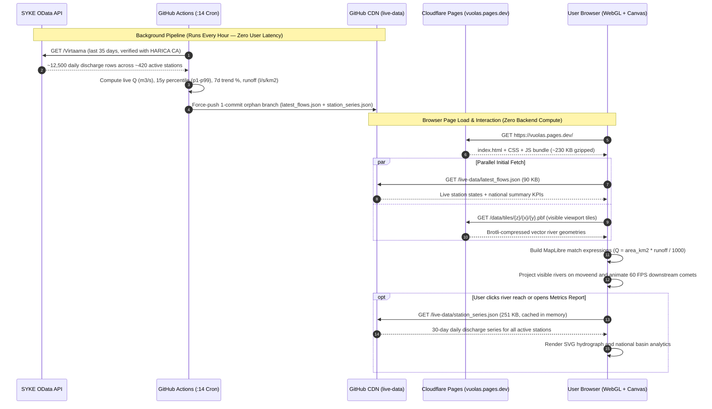

# Vuolas — Architecture & Data Flow

**Vuolas** separates static river geometry from hourly hydrological observations so the entire application runs serverlessly with **zero runtime database**, **zero API keys in the browser**, and **\$0/month hosting** on GitHub + Cloudflare Pages.

---

## 1. End-to-End System & Data Pipeline Diagram

```mermaid
flowchart LR
    subgraph Sources["1. External Open Data (CC BY 4.0)"]
        UOMA["SYKE Uomaverkosto (42,578 segments, EPSG:3067)"]
        ODATA["SYKE Hydrologiarajapinta OData v1.1 (Paikka + Virtaama)"]
        CERT["HARICA / GEANT Intermediate CA (certs/)"]
        OFM["OpenFreeMap CDN (OSM Vector Basemap)"]
    end

    subgraph Build["2. Offline GIS Prep (One-Time Local)"]
        PREP["scripts/build_network.py (Graph Area + 15y Percentiles)"]
        BASE["stations_baseline.json (168 KB in main)"]
        TIP["Tippecanoe Tile Slicer (z4-z10 .pbf)"]
    end

    subgraph Edge["3. GitHub + Cloudflare Serverless Edge"]
        MAIN["GitHub Repo (main branch: mikaa3/vuolas)"]
        GHA["GitHub Actions Hourly Cron (scripts/fetch_live_flows.py)"]
        LIVEDATA["GitHub Orphan Branch (live-data via Fastly CDN)"]
        CFP["Cloudflare Pages (vuolas.pages.dev + 2,110 .pbf tiles)"]
    end

    subgraph Browser["4. User Browser Runtime"]
        ML["MapLibre GL JS WebGL Engine (Dynamic station_id Join)"]
        CANVAS["60 FPS Flow-Comet Canvas (Downstream Droplets)"]
        UI["Interactive UI (30d SVG Hydrographs + Metrics + Guide)"]
    end

    UOMA --> PREP
    CERT -. "TLS Chain Verification" .-> ODATA
    ODATA -- "15y Historical Sample" --> PREP
    PREP --> BASE
    PREP -- "rivers_wgs84.geojsonl" --> TIP
    TIP -- "2,110 .pbf files" --> MAIN
    BASE --> MAIN
    MAIN -- "Auto Deploy on Push" --> CFP

    BASE --> GHA
    ODATA -- "Last 35d Virtaama" --> GHA
    GHA -- "Force-push single commit" --> LIVEDATA

    CFP -- "App + /data/tiles/*.pbf" --> ML
    OFM -- "Dark Basemap Tiles" --> ML
    LIVEDATA -- "latest_flows.json (90 KB, CORS)" --> ML
    LIVEDATA -- "station_series.json (251 KB, Lazy)" --> UI
    ML -- "Screen-projected visible rivers" --> CANVAS
```

---

## 2. Hourly Update & User Visit Sequence Diagram

---

## 3. Data Artifacts & Transformation Summary

| Stage | Artifact | Size | Frequency | Purpose |
| :--- | :--- | :--- | :--- | :--- |
| **Raw GIS** | `Uoma10.shp` + `Uomasolmupisteet.shp` | 164 MB | Static (SYKE) | Directed polyline graph (`uomapistei` → `uomapist00`), node elevations, and river/lake classes (`uomaluokka` `1` vs `2`). |
| **Baseline** | `data/processed/stations_baseline.json` | 168 KB | Rebuilt as needed | Calibrated station coordinates, basin names, upstream areas (`km²`), and 15-year empirical percentiles (`p5`–`p95`). |
| **Vector Tiles** | `web/public/data/tiles/{z}/{x}/{y}.pbf` | 18 MB raw (~6 MB Brotli) | Rebuilt as needed | 2,110 static Mapbox Vector Tiles (`z4–z10`) carrying `uoma_id`, `area_km2`, `is_lake`, `is_measured`, `station_id`, and `basin`. |
| **Live Snapshot** | `latest_flows.json` (`live-data` branch) | ~90 KB | Hourly (`:14`) | Latest `Q` (`m³/s`), `pct` (`1–99`), calibrated runoff `r` (`l/s/km²`), 7-day trend `%`, and national KPI summary. |
| **Time Series** | `station_series.json` (`live-data` branch) | ~251 KB | Hourly (`:14`) | 30-day daily `[date, q]` arrays lazy-loaded only when inspecting a station or opening the **Metrics** report. |
